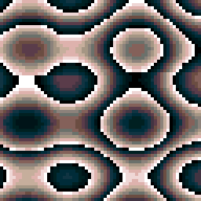
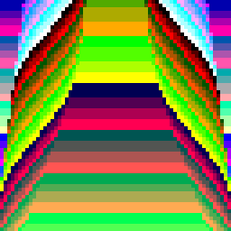

# openfpga-gametank
Gametank for the Analogue Pocket

The GameTank is an 8-bit game console based on the W65C02S, a 6502-family CPU from Western Design Center. It has a 128×100 pixel display with 200 unique colors -ΛERIF°RM (https://wiki.gametank.zone/) -Clyde

https://gametank.zone/
https://github.com/aeriform-io/minicube64 (replace)

AI use: Yes this is ai, but NOT a slop core, this uses mostly human modules (Arlet 6502 by Arlet Ottens and Anders). I wrote this myself. I hand tested all roms, everything should work; if not submit issues or pull requests please. For those curious, I used DeepSeek V4.1 Flash 10/17 max reasoning in freebuff. 

  <table align="center">
    <tr>
      <td></td>
      <td></td>     (replace or deltete)
      <td></td>
    </tr>
  </table>

Credits: Clyde Shaffer for GameTank itself and docs. Arlet Ottens and Anders for the 6502 cpu. Nikiiv for the MiSTer core (https://github.com/nikiiv/GameTank_MiSTer) and many more.

Licenses: I am not a lawyer, but some components of this used GPLv3 and that is why this is GPLv3
